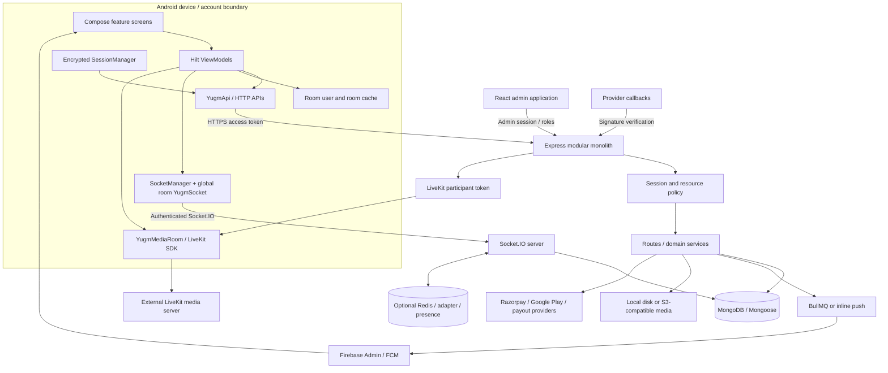

# Architecture and discovery evidence

Baseline `300826a`. Configuration checked in Git is evidence of intended behavior, not proof of the running deployment.

## Processes, dependencies and trust boundaries

Untrusted boundaries include Android/admin inputs, provider callbacks, socket packets, multipart bytes, media URLs and external provider responses. HTTP session authentication exists; authorization must still be established independently for each resource, account, financial command and subscription. Redis is optional in source and must not be assumed deployed. Mongo transactions require an appropriate topology which has not been confirmed.

## Android inventory

`android-client/settings.gradle.kts` includes 22 modules: `app`; core `model`, `api`, `ui`, `util`, `data`, `navigation`; and features `auth`, `discover`, `room`, `profile`, `social`, `wallet`, `settings`, `chat`, `room-modes`, `missions`, `events`, `gift`, `moderation`, `creator`.

| Responsibility | Actual source |
|---|---|
| App/session orchestration | `android-client/app/src/main/java/com/yugm/app/MainActivity.kt`; `ui/viewmodel/MainViewModel.kt` under the same package |
| Navigation | `app/.../navigation/NavGraph.kt`; feature-specific navigation graphs; `core/navigation/.../Screen.kt` |
| HTTP facade/contracts | `core/api/src/main/java/com/yugm/app/core/api/YugmApi.kt`, `IYugmApi.kt`, `YugmHttpClient.kt`; feature API files such as `EventsApi.kt`, `WalletApi.kt` |
| Global account realtime | `core/api/src/main/java/com/yugm/app/core/api/SocketManager.kt` |
| Room realtime | `core/api/src/main/java/com/yugm/app/core/api/YugmSocket.kt` |
| Media | `core/api/src/main/java/com/yugm/app/core/api/YugmMediaRoom.kt`, `RoomAudioForegroundService.kt` |
| Credentials | `core/data/src/main/java/com/yugm/app/core/data/SessionManager.kt` |
| Persistent cache | `core/data/src/main/java/com/yugm/app/core/data/local/CacheDatabase.kt`, `UserEntity.kt`, `RoomEntity.kt` |
| Chat orchestration | `feature/chat/src/main/java/com/yugm/app/feature/chat/viewmodel/ChatViewModel.kt` |
| Room/mode lifecycle | `feature/room/src/main/java/com/yugm/app/feature/room/viewmodel/RoomViewModel.kt`; `feature/room-modes/src/main/java/com/yugm/app/feature/roommodes/viewmodel/RoomModesViewModel.kt` |
| Push presentation | `app/src/main/java/com/yugm/app/YugmFirebaseMessagingService.kt` |
| Security declarations | `app/src/main/AndroidManifest.xml`, `app/src/main/res/xml/network_security_config.xml` |
| Builds | Gradle / Kotlin / Compose / Hilt / KSP. Chat already uses KSP; no pending KAPT migration established. |

`...` in the navigation table is descriptive only; concrete files for the material findings are specified in the other rows. This audit found no persistent message/pending-command cache or WorkManager recovery path. It did find encrypted session storage, centralized refresh mutex, GET-only explicit retry, account and room socket managers, and media disconnect cleanup.

## Backend and alternate entry points

The API is an Express/Mongoose modular monolith: 44 non-test route source files and 83 non-test model source files. `backend-server/packages/shared` owns shared enums/contracts. `backend-server/apps/admin` is an additional client with privileged routes.

- **HTTP mounts:** `apps/api/src/app.ts:203` onward; complete static inventory in `endpoint-inventory.csv`. Review both router-wide and route middleware and actual Express execution order.
- **Socket mutations/subscriptions:** `services/socket.ts`, including handshake, room join/leave and typing; inventory in `socket-inventory.csv`. Provider media uses LiveKit rather than bespoke SDP/ICE routes in the inspected call flow.
- **Payment callbacks:** raw-body payout webhook registered before JSON parsing at `app.ts:127`; other payment/verification routes under wallet/subscriptions. Audit each verified callback and fulfillment service as a separate entry point.
- **Jobs:** `services/jobs.ts` starts BullMQ push jobs when configured and otherwise inline push; maintenance runs every 15 minutes. Tasks delete aged accounts, expire stories/VIP/suspensions, clean stale rooms and prune clan messages. Side effects and retention require their own policy review.
- **Startup mutations:** `index.ts:25` onward connects DB, creates indexes, runs migrations, ensures cosmetics/achievements/official rooms, initializes Redis/jobs/socket infrastructure and resumes PK timers. Do not invoke bootstrap against unknown credentials for testing.
- **Static media/admin:** `/uploads` and `/assets` are static mounts at `app.ts:150`; `/admin` serves the built admin application. Private verification media is served through a different authorized path. Private chat attachment ownership/download policy remains unproven.
- **Admin tools and scripts:** `routes/admin*.ts`, `services/auditLog.ts`, `scripts/seed*`, `scripts/backfill-progression.ts`, restore/maintenance scripts. The HTTP inventory includes route declarations; scripts must be separately reviewed before execution.

## Command traces and authority

| Operation | Existing end-to-end path / authority | Delivery category and gap |
|---|---|---|
| Direct message | ChatScreen → ChatViewModel → User/Chat API → `routes/users.ts` auth/block checks → DirectMessage create → notifications/XP → socket/client merge | Durable command. No retained client command identity, atomic result/outbox, or pending local store; accepted-message side effects can fail afterward. |
| Room/direct gift | UI/API → `routes/wallet.ts` → wallet/diamond helpers + GiftTransaction Mongo session → post-commit XP/notification/chat/activity | Durable command. Main paths have stronger authorization than `routes/gifts.ts` alternatives; key binding and effect recovery incomplete. |
| Inventory trade/combo | Inventory/room API → `routes/gifts.ts` → `services/gifts.ts` → balance/inventory mutations | Durable commands. Actor consent boundaries defective (GIFT-001/002). |
| Private call | ChatViewModel → startPrivateCall → `routes/users.ts` → private Room/participants/message transaction → notification → voice/video room → LiveKit token | Durable call control is currently represented by Room state; no authoritative ring/accept/device ownership protocol found. |
| Event registration | EventsScreen/EventViewModel → EventsApi → currently mismatched mount → `routes/events.ts` → participant array save | Durable command/state synchronization. Route mismatch and capacity/join-leave races. |
| Typing/presence | Socket clients → authenticated connection → typing handlers / Redis presence and socket maps | Ephemeral signals. Direct typing needs policy parity; ongoing session expiry/revocation and lease recovery need proof. |
| Read receipts/edits/reactions | ChatViewModel/API → message routes → stored flags/content/reactions → socket updates | Durable synchronization. Needs monotonic receipts, revisions and deletion/change recovery. |
| Notification | Domain service → Notification record → socket emit → optional job/FCM → Android presentation | Push is a hint. Domain mutation and notification not atomic; dedupe/account targeting/retry require follow-up. |

Server database is authoritative for balances, message content, membership, entitlements and event registration. Presence is ephemeral, not a durable user online flag. Android caches must be partitioned by account; current delayed-token substitution violates that boundary. Local Room currently stores discovery cache, not a synchronized message command journal.

## Schema and data-quality inventory

`schema-inventory.csv` records field definitions and explicit `.index(...)` declarations. Important groups include User/AuthSession/DeviceToken; Room/RoomParticipant/RoomFollow; DirectMessage/ChatMessage/ClanMessage; Gift/GiftInventory/GiftTransaction; WalletTransaction/DiamondTransaction/Purchase/WithdrawalRequest; Event; Notification; and moderation/audit schemas.

Existing financial unique indexes and conditional debit are useful safeguards. Declared indexes are not proof that live indexes exist. `services/productionIndexes.ts:75` drops a legacy purchase index and calls createIndexes on a selected model list. `config/migration.ts` has startup migrations but no inspected isolated rehearsal or duplicate preflight.

Actual duplicates, negative balances, journal gaps, orphan media/references, malformed event membership, pending purchase/refund state, and account deletion residuals are **NOT VERIFIED**. No production query was run. Plan read-only, bounded queries against a sanitized snapshot, define reconciliation units/accounts first, and never repair money or merge historical records automatically from assumptions.

## Environment, CI and deployment

| Item | Repository evidence | Unknown / constraint |
|---|---|---|
| Hosting | `render.yaml` describes Node web API with `/health` | Actual service plan, region, instance count, disk persistence, scaling and deployed environment not inspected |
| Mongo | `config/db.ts` uses Mongoose with runtime URI/db name | Replica set/Atlas mode, access/backup policy, live indexes and transaction support unknown |
| Local DB | `backend-server/docker-compose.yml` launches `mongo:7` | No replica set initialization; not sufficient for transaction integration tests |
| Redis/queues | Optional Redis, Socket.IO adapter and BullMQ | Actual shared Redis readiness, lease/fanout semantics and multi-instance recovery unknown |
| Media | LiveKit SDK/token service and optional local/S3 storage | Credentials, TURN/relay, bucket access/privacy/lifecycle and provider connectivity unverified |
| Payments | Razorpay, Google Play and payout services | Sandbox access/merchant state/reconciliation not verified; no real purchase/refund executed |
| CI | `.github/workflows/ci.yml` declares backend typecheck/tests, Android lint/unit/debug | Remote runs and passing status not inspected; existing schema tests do not prove races |
| Deployment | `render.yaml` uses `autoDeployTrigger: commit`; deploy workflow fires on backend master push | A master push can deploy independently of CI and APK release; coordinate explicit staging/production gates |
| APK release | `.github/workflows/android-release.yml` triggers on `v*` tags | User instruction prohibits future APK release; no tag/release created |

Locally, Node/npm are available. `Get-Command docker,mongod` found neither on PATH; that is not proof no remote or differently installed test environment exists. No credentials/environment files were read. No provider/network request was made for this audit.

Metrics, health and logs are present but not a production baseline. Local source shows concrete URL metric keys and detailed public health responses. No latency percentile, crash/retry outcome, backup coverage, RPO/RTO, restore duration, dependency SLA, or device resource measurement is claimed.
