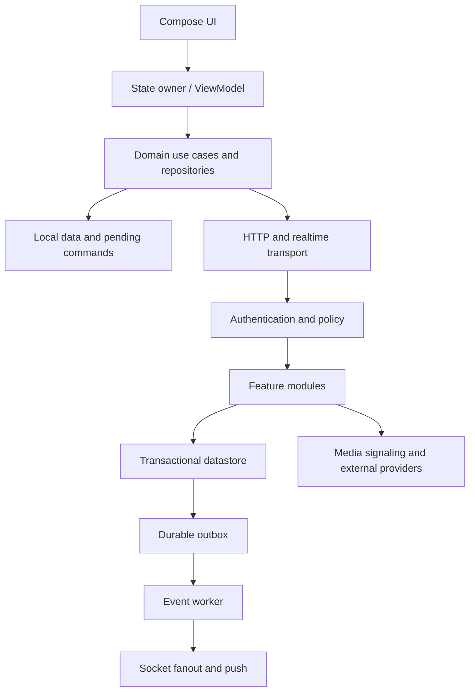
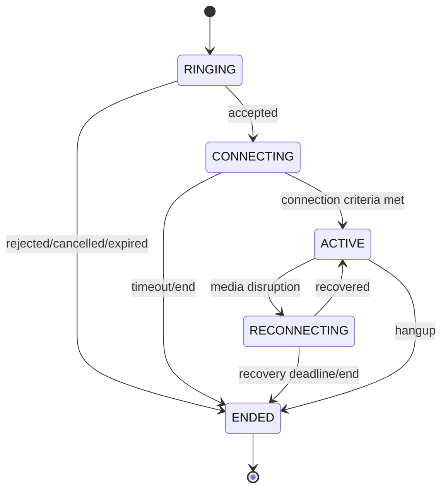

# YUGM
## Production engineering, reliability and security implementation blueprint

**Version:** 1.0 | **Status:** Proposed implementation baseline | **Date:** 17 November 2026

### Purpose and scope

This is an actionable engineering specification for auditing and incrementally hardening Yugm across its Android client and backend. Known features include private text messages, attachments, reactions, edits, voice/video calls, discovery, gifting, events and premium restrictions. Android uses Kotlin, Compose and Hilt. The backend has been described as hosted on Render. Database, media provider, payment provider, event semantics and actual deployment topology must be verified in the repositories. Nothing in this proposal is evidence that a particular safeguard already exists or is absent.

The objective is not to introduce every fashionable distributed-systems pattern. It is to prove the relevant invariants on every important execution path, implement the smallest viable safeguards, preserve existing UX and data, and establish safe operations.

## 1. Non-negotiable engineering contract

| Area | Required properties | How to prove them |
|---|---|---|
| Persistence | Atomicity, consistency, isolation, durability | Database integration tests, constraints and crash/retry scenarios |
| Operations | Idempotency, deduplication, replay safety | Repeat identical requests concurrently; assert one business effect |
| Concurrency | Isolation, conflict detection, fencing, atomic conditional updates | Race tests using real datastore |
| Messaging | Per-stream ordering, durable acceptance, eventual convergence | Drop acknowledgments, reconnect and compare server/client state |
| Calls | Authenticated signaling, finite state machine, expiry, cleanup | Simultaneous accept/cancel, network handoff, process death |
| Security | AuthN, AuthZ, input validation, confidentiality, least privilege | Negative authorization tests for each transport and resource |
| Resilience | Bounded retries, deadlines, backpressure, graceful degradation | Inject network, process and dependency outages |
| Operations | Traceability, reconciliation, observability, disaster recovery | Alerts, replay tools, restore drills and measurable indicators |
| Compatibility | Versioned contracts, expand/contract migrations, safe rollout | Old client/new server tests and rollback rehearsal |
| Safety | Block/report enforcement, abuse resistance, privacy and retention | Cross-feature abuse and privacy tests |

Classify each operation into one of three delivery categories:

1. **Durable commands:** send message, send gift, register event, purchase, edit/delete. Persist before acknowledging; use stable operation identity and recoverable results.
2. **Durable state synchronization:** message receipts, membership, call outcomes, entitlements, cancellations. Version or sequence changes, support snapshots/deltas and replay.
3. **Ephemeral signals:** typing, presence heartbeat, media quality updates, transient ICE candidates. Bound lifetime and memory; allow expiry or loss where protocol permits; never queue stale live signals indefinitely.

No promise of exactly-once network delivery. Achieve exactly-once *business effects* where required through persistent identity, atomic commit and deduplication.

## 2. Work package D0 — Repository discovery and evidence

**Prerequisites:** read actual repository instructions, inspect git status, identify branches and existing user changes, obtain non-production test configuration. No production deployments, destructive migrations, real purchases or stress tests against live users.

1. Inventory Gradle modules, app entry points, navigation, Compose screens, state holders, Retrofit/HTTP client, WebSocket client, local storage, Hilt modules, workers, manifests and environment-specific builds.
2. Inventory server routes, auth middleware, socket subscription and signal handlers, service/repository layers, database or ORM, schemas/indexes, migrations, jobs, push delivery, media storage, payment integration and hosting configuration.
3. Trace each operation end-to-end: UI action → state owner → network contract → auth → domain authorization → transaction → durable record → response → broadcast → local sync → final UI.
4. Enumerate all alternative entry points including legacy routes, webhooks, admin tools, scheduled jobs and direct socket mutations. A UI guard is not server enforcement.
5. Locate actual logs and measure baseline latency, error rates, reconnect behavior, query plans, build times and device resource use with sanitized data.
6. Record unknown or inaccessible components explicitly.

**Required artifacts:**

- Architecture map with process boundaries, external dependencies and trust boundaries.
- Endpoint/command/event inventory, including auth policy, IDs, side effects, transaction scope, retry policy and owner.
- Existing schema inventory and data-quality report.
- Requirement matrix with status VERIFIED / PARTIAL / MISSING / DEFECTIVE / NOT APPLICABLE / NOT VERIFIED.
- Finding register: ID, severity, evidence (path/function/line/commit), reproducible failure, invariant violated, fix, tests, migration, rollback and owner.

Example evidence record: CHAT-001; P0 if verified data loss; message ACK precedes database commit; reproduction by terminating backend after ACK; fix commit-before-ACK; verify persistent record on restart. This is a hypothetical example, not a finding about Yugm.

Severity: P0 = unauthorized access, financial divergence, durable data loss; P1 = duplicate effects, unrecoverable workflow, call corruption, severe abuse; P2 = performance/reliability degradation; P3 = maintenance. Evidence determines priority.

## 3. Target architecture and ownership



Keep a modular monolith unless measured scale or isolation requirements justify extracting services. Proposed server domain boundaries: identity/session, social graph/policy, messaging, calls, gifting/wallet, events, media, notification, audit and operations. A common infrastructure layer owns database transactions, clock, operation identities, authorization middleware, error mapping, telemetry and durable event publishing. Feature modules own their specific invariants and should not mutate another module's records ad hoc.

### Source-of-truth matrix

| State | Authoritative owner | Android responsibility |
|---|---|---|
| Message content, sequence, edits | Server database | Local synchronized read model and pending local drafts |
| Delivered/read watermark | Server per authenticated participant/device policy | Monotonic update based on actual client behavior |
| Presence | Expiring connection leases | Render cached presence as possibly stale |
| Call lifecycle | Server call-session state; media health from RTC peers | Maintain local RTC session, reconcile with server |
| Wallet and gift pricing | Server ledger and catalog | Render balance and quote; never finalize |
| Event capacity and registration | Server event/registration records | Show pending until confirmed |
| Entitlements and block policy | Server policy state | Cache only for UX, enforce every command server-side |

## 4. Work package F1 — Shared operation protocol

### 4.1 Identities and request semantics

Reuse existing identifiers if adequate. Introduce stable client operation IDs (random UUID or equivalent) once per user intention, not once per HTTP attempt. Generate them before persisting the pending command. Use request IDs per attempt and a trace/correlation ID across downstream work. Bind idempotency scope to authenticated actor, command type and operation key. Hash canonical semantically relevant inputs; never hash opaque nondeterministic headers. Reusing a key for different input is a conflict, not a new command.

Example illustrative contract (adapt names/types to existing APIs):

```http
POST /v1/conversations/{conversationId}/messages
Authorization: Bearer <access-token>
Idempotency-Key: <stable-operation-id>
X-Request-Id: <attempt-id>
Content-Type: application/json
```

```json
{
  "clientMessageId": "uuid-generated-once",
  "content": {"type": "TEXT", "text": "Hello"},
  "replyToMessageId": null
}
```

Response includes operation ID, canonical entity ID, server revision/sequence, committed state and timestamp. Replay returns the same committed outcome, subject to current access/privacy checks. Define status lookup for uncertain results. Use documented machine-readable error codes with redacted details.

| Error category | Typical client behavior |
|---|---|
| Invalid input / forbidden | Permanent failure; no blind retry |
| Expired authentication | Refresh once via single-flight; then re-evaluate |
| Conflict / stale version | Fetch canonical state, resolve or ask user |
| Idempotency input mismatch | Reject; do not reuse key |
| Rate limited | Respect server retry guidance, apply jitter |
| Transient failure / timeout | Keep uncertain result; retry same key or query status |
| Terminal business rejection | Show stable reason; new user intent required |

### 4.2 Transaction boundaries and idempotency

Conceptual synchronous handler: authenticate → validate shape → authorize resource → begin transaction → reserve scoped unique operation key → verify current business conditions under transaction → apply domain write(s) → insert outbox event(s) → persist committed operation result → commit → return response.

Concurrent reservation must use the datastore's actual atomic uniqueness/locking primitive, not a check-then-insert outside a transaction. Local domain effect and saved committed result must share the atomic boundary. A duplicate should wait within a bounded deadline or fetch the winner's result; reject mismatched payloads. For long external workflows persist an operation with state and a durable provider reference instead of keeping a transaction open across the network. Use lease/fencing or equivalent ownership if jobs can be claimed by multiple workers.

Store only necessary operation result metadata. Define expiration at least as long as the intended retry window; retain durable business uniqueness identifiers for money or other irreversible effects beyond generic cache expiration. Access controls still apply to replays and status checks.

### 4.3 Data model (logical, not migration DDL)

| Entity | Essential keys/fields and rules |
|---|---|
| operation | actor_id, kind, key (unique tuple), request_hash, state, result_ref, dates |
| outbox | event_id unique, aggregate_id, revision, type, payload/schema version, next_attempt, lease, attempts, published_at |
| consumed_event | consumer_id + event_id unique; commit with consumer effects |
| audit_event | actor, action, entity, outcome, time, trace; redacted details and controlled retention |
| session | user, session/device_id, expiry, revocation, refresh rotation state |

For relational datastores evaluate unique/check constraints, row locking and conditional writes; retry whole transactions on retryable isolation conflicts. For document/NoSQL stores use supported transactions, compound unique indexes and conditional versioned writes; verify actual deployment supports required semantics. If an invariant spans stores and cannot commit atomically, design a saga/reservation and reconciliation protocol. Never simulate critical atomicity with a process-local mutex.

### 4.4 Outbox/inbox

Outbox publication is at-least-once: after business commit a worker claims available rows with bounded leases, publishes, and marks completion. If the worker crashes after publish and before marking, duplicate delivery occurs by design. Consumers deduplicate durable effects using event ID and consumer ID in their own transaction. Use aggregate sequence/revision for reordering; detect gaps and sync when needed. Use bounded batches, capped exponential backoff plus jitter, dead-letter reason, alerting, replay tooling and redacted failed-payload diagnostics. Replays must preserve original IDs. Do not add an external broker solely for a small traffic volume if durable database workers suffice.

**F1 acceptance:** 100 identical parallel test commands produce one committed business change; change payload under same key yields conflict; kill process after commit before response and confirm retry yields original result; crash worker before/after publish and prove no lost durable event or repeated consumer effect.

## 5. Work package F2 — Identity, authorization, privacy and abuse

Centralize authentication on HTTP and WebSocket handshake and re-check session expiration/revocation on relevant connection operations. Derive actor identity from verified auth; ignore body-supplied actor IDs. Validate subscription membership and authorize every incoming socket command, even if a user joined the room earlier. On block, membership removal or session revocation, revoke subscriptions and close or constrain affected channels.

Define a server-side policy decision per action/resource, including participant membership, ownership, block relationship, event visibility, entitlement, ban status and role. Apply it to send, history, attachment download/upload, call invite/accept, gift, event access, moderation and admin tasks. Explicitly decide block semantics for existing conversations, history, active calls, gifts and event co-attendance; document tests and product exceptions. Prevent time-of-check/time-of-use races for policy-sensitive writes through suitable transaction/version checks where warranted.

- Verify token expiry, issuer/audience/signature as relevant, refresh rotation/reuse policy, single-flight refresh and sign-out cleanup.
- Store credentials in suitable Android protected storage with appropriate key handling; never persist raw tokens in logs or shared files.
- Enforce TLS, restrict network cleartext, load secrets from runtime configuration, rotate credentials, apply least-privilege datastore/provider access.
- Validate payload shape, length, multipart size, media type/signature, object ownership and quota. Signed media URLs must be short lived and scoped to authorized content; access after revocation is bounded by expiry or stronger proxy design.
- Rate-limit by relevant authenticated actor, device/IP and operation; do not trust caller-supplied identity. Use burst and sustained limits, global protection, bounded queue limits and appropriate distributed enforcement if multiple instances.
- Protect against enumeration, replay, mass assignment, injection, SSRF from remote media references, oversized frames, forged webhooks and abusive invite/message patterns.
- Log administrative actions; require role-specific authorization and least privilege.
- Define retention/deletion for messages, media, reports, logs, backups and payment records. Clear local account data and cancel pending account work on logout; guard cross-account results.
- Threat model abuse: unwanted calling, spam, impersonation, harassment, scams, gift fraud, harmful attachments, event spam and evasion of blocks. Add report flows, authorized moderation, cooldowns, sanctions, evidence handling and appeal/escalation policy as product requires.

Do not claim E2EE if servers can decrypt stored message content or access media keys; review provider trust and explicitly describe the real encryption boundary. Exact jurisdictional/platform privacy/payment obligations require independent review.

**F2 acceptance:** fuzz identifiers across accounts on REST and sockets; zero unauthorized reads/writes in test suite; expired/revoked sessions cannot continue commands; blocked-user rules enforced on all transport paths; attachments cannot be fetched by unrelated users.

## 6. Work package M1 — Text messaging and local-first synchronization

### 6.1 Server records and ordering

Logical entities: conversation, participant/membership, message, message_revision or tombstone, message_attachment, reaction, receipt_watermark, conversation_change_event. Unique client message identity must be scoped to sender and conversation (or globally stable and explicitly owned). Use a server-authoritative per-conversation sequence for message order, allocated in the same transaction as message persistence; use a separate revision/change cursor for edits, deletions and reactions. Never assume client timestamps reflect canonical order; use server time for business windows. A sequence gap is not inherently a lost message if the allocator permits gaps; make the sync protocol explicit about what is recoverable and which cursor represents a contiguous applied prefix.

Message send:
1. Android inserts pending message and durable command locally in one transaction.
2. Repository attempts send with stable client message/operation ID.
3. Server verifies membership, blocking, text limits and attachment ownership/readiness.
4. Server allocates order, writes message plus receipt/result metadata and outbox in one transaction.
5. ACK only after commit. Socket notification may arrive before HTTP response; local upsert merges by client ID/canonical ID and revision.
6. Recipient syncs canonical data, optionally emits delivered watermark when actually persisted locally; emits read watermark only when read policy is satisfied.
7. Sender receives receipt change, converges without duplicate bubbles.

Delivery and read semantics must be explicitly defined (accepted by server vs delivered to at least one authorized device vs delivered to all devices vs read by user). Push delivery alone does not prove the message was received/read. Monotonic watermarks or per-message receipts should match product behavior; do not regress receipt state from delayed events.

### 6.2 Android durable queue and reconciliation

If not already implemented, use an appropriate Room-backed local message/cache and pending command store. UI reads observable local state; use repository to synchronize network and local records. WorkManager is suitable for persistent, deferrable recovery; an active foreground connection may perform low-latency sends. Coordinate both via an atomic claimed operation or rely on server idempotency; prefer both. Partition state by account, scope pending workers to the authenticated account, and cancel/guard them when the account changes.

Local statuses: DRAFT, QUEUED, SENDING, UNKNOWN, ACCEPTED, FAILED_PERMANENT; separately represent delivery and read status. Store retry count, next attempt, last error, request hash or immutable parameters and operation ID. On process death, stale SENDING claims become retryable; do not mark UNKNOWN as permanently failed just because the network timed out. After permanent rejection, surface retry/edit UI that creates a new intent when payload changes.

Reconnect flow: authenticate socket → establish subscription with cursor/resume or buffer events while fetching a catch-up snapshot → apply missing changes and buffered events idempotently by ID/version → persist cursor only when local apply succeeds → retry pending commands. Avoid snapshot/subscription gap; late events should not overwrite newer state. If cursor expired, rebuild scoped snapshot and preserve pending local commands. Use stable pagination by canonical sequence or opaque cursor, not shifting offset across new messages.

### 6.3 Message mutations

- Edit: validate actor and server-side edit window; use expected revision or documented last-writer policy; increment revision and emit change.
- Delete-for-me: per-user visibility tombstone. Delete-for-everyone: authorization, configured time limits, canonical tombstone and propagated revision. Avoid resurrection by delayed sends/edits.
- Reaction: unique (message, actor, reaction type) or (message, actor) per product model; explicit add/remove commands, not blind toggle.
- Reply/forward: authorize source and destination; snapshot permitted quote or maintain reference with deletion/privacy rules; forwarding must not bypass recipient permissions.
- Batch delete: define all-or-nothing vs per-item results; each item authorized.
- Conversation unread: derive from sequence/read markers with chosen visibility rules; avoid lost updates to cached counters.

**M1 acceptance:** rapid double tap, lost ACK, duplicate/out-of-order events, network reconnect, process kill, multi-device reads/edits/deletes, concurrent reactions and pagination while new messages arrive all converge to canonical state. assert one bubble per accepted client message ID, valid receipt progression, no phantom committed send and no stale resurrection.

## 7. Work package M2 — Media, voice notes and file uploads

Separate media transport from message persistence. Upload lifecycle: CREATED → UPLOADING → UPLOADED → VERIFYING → READY or FAILED/EXPIRED. Server issues bounded upload session; client uploads with progress, cancellation and resumability if supported; validate size, checksum where applicable, content type, actual file signature, ownership and scan/quarantine policy. Commit attachment metadata only when verified, then create message referencing READY object. Where user experience requires a pending placeholder, expose it as not delivered until commit. Track orphan sessions and reclaim only after retention/grace period, checking references. Do not trust arbitrary URL or object keys as proof of ownership.

Android: handle URI grants, content resolver streams, upload memory bounds, image resizing/compression without blocking main thread, audio capture permissions, codec errors, cancellation, temporary-file cleanup and process-death recovery. Persist staging files only as needed with scoped access. Dispose media players and recording resources; a single playback owner avoids overlapping players where product requires it. Apply media size/length limits and authorization for download.

**M2 acceptance:** interruption at each stage does not create a visible broken attachment or charge; retry same upload/message safely; unauthorized object referencing fails; cleanup cannot delete referenced media; no leaked recorder/player on exit.

## 8. Work package C1 — Voice/video calling and real-time signaling

### 8.1 Call session state

Use actual RTC/provider SDK and avoid reimplementing it. Define server authoritative call ID, caller/callee, media type, revision, negotiation generation, creation/expiry/accept/end timestamps, terminal reason, device ownership and policy decision. Distinguish call lifecycle from local media connectivity.



Terminal call is immutable for lifecycle purposes. Late invite/accept/answer/ICE cannot reopen it. Record terminal reason and required billing/duration info once; reconcile disputed or missing outcomes. Validate each transition by role, current state and revision under a transaction or atomic conditional update. Use server expiry/deadlines and state lookup, not local timer as authority.

### 8.2 Signaling protocol

Each durable command includes callId, operationId, expectedRevision where required, action, authorized device identity. Signaling envelope includes callId, negotiationGeneration, signalId, type and bounded payload. Deduplicate durable commands; drop stale or unauthorized generations. Buffer early ICE candidates only until appropriate remote description arrives, with bounds and TTL. Handle simultaneous offers (glare) with deterministic role assignment or SDK's proven negotiation pattern; decide simultaneous reciprocal invites by policy. Allow one authorized device to win accept; others stop ringing on canonical update. Reject stale sessions or unauthorized answer/offer routing. Cap candidate queue, SDP size and signaling frequency.

Invite/reject/accept/end are durable call control; transient signaling and media can be recovered or renegotiated, not persisted indefinitely. Ensure cancellation and accept have one valid serial outcome. When reconnecting, fetch authoritative session and restart ICE/renegotiate if allowed; do not replay obsolete offers. Use provider-supplied STUN/TURN architecture with short-lived credentials when applicable. Test relay connectivity, NAT/firewalls, IPv4/IPv6 if supported; protect TURN from open relay abuse. Use secure transport and provider media encryption.

### 8.3 Android call lifecycle

Integrate proper incoming call notifications, user-visible call state, permission requests, foreground service declarations/types and OS restrictions appropriate to actual target SDK/device matrix. Never start recording or camera without appropriate user permission and action. Handle audio focus, speaker/earpiece/Bluetooth, camera switch, mute, foreground/background, screen rotation, app process recreation, connectivity change and interruption. Centralize resource ownership outside a giant screen composable; stop tracks, capturers, peer connections, renderer surfaces, timers, listeners and service work exactly once on terminal paths. Separate call UI state from network/media callbacks and serialize state updates.

**C1 acceptance:** 2-device and multi-device tests of simultaneous invites, accept/cancel, double accept, early or duplicated ICE, late answer after end, reconnect/handoff, denied permission, app background/process death and TURN-only network. At most one accepted ownership where product requires it; no active mic/camera after terminal end; no ghost call state.

## 9. Work package G1 — Gifts, wallets, payments and entitlements

First confirm whether gifts are free, purchased, inventory-based or backed by virtual currency, and whether cash-out or transfer exists. Do not create a payment system if not needed. For valuable gifts, server owns catalog price, currency, quantity, balance, restrictions, liability and recipient rules. Use integer minor units or fixed precision appropriate to each currency; never floating-point money. Explicitly distinguish purchased credits, promotional credits, real money and recipient reward units; never mix units in ledger arithmetic.

### 9.1 Logical entities and constraints

wallet/account (owner, unit, available/reserved balance, revision), ledger_transaction (operation reference unique, type, state), ledger_posting (account, signed units, transaction), gift_catalog (price/version, active), gift_transfer (sender, recipient, gift, operation unique, amount/unit), purchase (provider reference unique, order, state), provider_event (provider + event_id unique), entitlement (source purchase, valid interval, revoked). Use existing models where equivalent. Dedicated immutable journal with balanced postings per unit if double-entry model applies. Any cached balance must be updated atomically with journal postings and periodically reconciled. Credits/fees/rewards must map to defined accounts or explicitly documented issuance/burn policies.

### 9.2 Atomic gift send protocol

1. Authenticate and authorize sender/recipient and current policy.
2. Reserve scoped operation identity; confirm quote or current price according to explicit catalog policy.
3. Lock affected account(s) in consistent key order or use correct atomic conditional updates; validate quantity, limits and available funds *inside* transaction.
4. Apply debit and credit/reservation/consumption accounting; write ledger postings and transfer record together; prevent negative available balance unless explicitly designed and authorized.
5. Insert outbox event and result; commit. Only after commit send notification/chat gift card from durable gift ID.
6. Retries with same key return same transfer; UI waits for authoritative outcome. A failed chat animation or socket delivery cannot cause repeated financial effect.

Illustrative relational conditional debit:

```sql
UPDATE wallet
   SET available_units = available_units - :cost
 WHERE wallet_id = :sender_wallet
   AND available_units >= :cost;
```

Require one affected row and execute inside the same transaction as the transfer, ledger and outbox. Validate positive cost; check recipient and accounting policy; do not use this snippet in isolation as a full implementation.

### 9.3 Provider payments and refunds

For existing provider integrations, create internal durable payment attempt with immutable quoted amount/currency, provider idempotency key and external reference. Provider calls occur outside local transaction; ambiguous results become PENDING_VERIFICATION and are looked up/reconciled, not blindly re-created. Accept verified callbacks/webhooks through signature verification using provider-required canonical/raw body; deduplicate provider event identities and financial effects. Match merchant/order/account, amount/currency and final permissible provider status. Handle reordered callbacks by state/version or provider authoritative lookup. Client-reported success only triggers status refresh. Never grant purchased units/entitlements twice for a provider purchase even if multiple event types indicate success.

State transitions: initialized → pending provider → verified → fulfilled, with failure/cancel/expiry paths; refunds/reversals are explicit linked operations with independent IDs and amount caps, not deletion of ledger records. Handle disputed/refunded purchases under explicit product policy (including insufficient remaining credits). Use daily or volume-based reconciliation and exception review; compare internal provider references, settled amounts, fees, refunds and entitlements against provider authoritative records.

Platform billing policy, payment provider details and regulatory implications depend on actual product/regions; verify current official requirements before implementing new purchase flows.

**G1 acceptance:** N concurrent gift sends cannot overspend; 100 repeats same ID charge once; loss of HTTP ACK after commit does not duplicate gift; failed ledger/outbox insert rolls everything back; webhook duplicates/reordering grant once; forged callbacks rejected; refund retries reverse once; ledger/account reconciliation has zero unexplained differences in fixtures.

## 10. Work package E1 — Events and participation

Audit event types first (scheduling, live participation, paid events, invitations). Model event state DRAFT → PUBLISHED → IN_PROGRESS → COMPLETED, with allowed CANCELLED path; registration states PENDING/HOLD, CONFIRMED, WAITLISTED, CANCELLED, EXPIRED as applicable. Server owns capacity, registrations, eligibility and deadline based on UTC; preserve event timezone for display and recurrence.

Logical entities: event (host, capacity, status, schedule, revision), registration (event + participant unique, state, operation), reservation (hold expiry/token), invitation (hashed scoped token, expiry, uses), attendance (unique event/session participant policy). For limited seats lock event row or atomically reserve capacity and insert registration within a single transaction; enforce capacity invariant over confirmed + nonexpired reserved seats according to policy. Never use a client count or unchecked read-then-write. Consistent lock order for cancellation and registration; waitlist promotion must be atomic and retry-safe. Expiry worker should only release the matching live reservation, not one subsequently confirmed. Paid registration uses a durable hold and payment workflow: confirm only when payment verified; if hold expired, compensate/refund per policy rather than silently oversell.

Validate host moderation, admission, membership/privacy, event updates, cancellation notifications, invitation replay, user blocks and attendance. Disconnects do not remove durable registration. Push reminders and cancellation notifications derive from durable state; dedupe by event/recipient/notification type/revision.

**E1 acceptance:** with one remaining seat and many parallel eligible users, exactly one confirmed seat (or one valid hold per policy); retries never duplicate registration; cancel and join race is valid; expiry cannot remove a renewed/confirmed hold; unauthorized event edits and token replay rejected.

## 11. Work package R1 — Connection, presence, notification and discovery

- One managed realtime connection per appropriate account/session scope; define connect/authenticate/subscribe/ready/reconnect/close states, heartbeat and inactivity detection, bounded exponential backoff with jitter, token refresh, listener unsubscribe and lifecycle ownership.
- Presence is a lease per authenticated connection/device with expiry; aggregate user online status if any active lease, apply last-seen privacy, avoid permanent online on crash. Heartbeats are ephemeral and coalesced.
- Typing signals include conversation/actor, TTL, authorization and rate bounds. Clear on timeout, send or leaving. No durable ledger for typing.
- Push is best-effort notification/hint, not authoritative data transport. Use durable message/call/event records, stable notification IDs, collapse where appropriate, account-specific device token registration/rotation and invalid-token cleanup. Restrict lock-screen content according to privacy. Deduplicate foreground socket vs push UI and validate deep-link targets server-side.
- Discovery: eligibility/visibility and block filters on server; pagination, bounded queries, deterministic ranking tie-breakers and privacy of online status; no cross-account cache leaks. Limit scraping, profile enumeration and expensive search.
- Horizontal scaling: do not assume process-local rooms, presence maps or job locks are shared. If multiple backend instances exist, use appropriate shared coordination/fanout and leases or existing managed realtime service. If a host sleeps/restarts, recover durable work; investigate actual Render service configuration, cold starts, websocket routing and quotas before deciding upgrades.

**R1 acceptance:** repeated reconnects never multiply subscriptions; logout revokes account state; no ghost online after lease expiry; missed push is recoverable through sync; blocked profiles do not reappear through stale search cache.

## 12. Work package A1 — Android structure, UI correctness and build performance

Use the existing module boundaries and preserve UI. Move orchestration out of oversized ChatScreen functions into feature-specific state owners/controllers, repositories and smaller composables. Proposed boundaries: chat header, message list, message bubble, input composer, attachments, dialogs, gift sheet, voice playback/recording and call navigation. Do not assume source-line count causes KAPT delay. Profile :feature:chat:kaptGenerateStubsReleaseKotlin separately, check compiler/Gradle/Hilt versions, task timings and heap/CPU; migrate KAPT to KSP only after verifying all processors and versions support it. Refactor large functions for correctness, testability and incremental performance; benchmark changes.

- ViewModel owns immutable UI state and dispatches domain intents; UI renders persistent observation and dispatches events. Use lifecycle-aware collection. Use scoped coroutine cancellation, structured concurrency, explicit dispatchers for blocking work and single-flight token refresh. Handle errors by category and do not swallow cancellations.
- Compose: stable keys, immutable updates, remember keyed to identity, appropriate side-effect scoping, lazy paging, avoid repeated subscriptions/recording during recomposition, save only appropriate ephemeral UI state. Persist durable work outside composable memory.
- Separate one-off navigation/snackbar effects from authoritative operation state. Do not silently repeat charge/send on rotate. Disable duplicate UI actions as UX only, not correctness.
- Define Hilt scopes for singleton connection manager, account-specific repositories/state, screen ViewModels and call session resources. Avoid leaking Activity contexts. Clean account-specific state on logout.
- Verify permissions, screen restoration, app background limits, accessibility, large text, localization/time zones, slow/offline network messaging, low-memory process death and battery/thermal behavior.

**A1 acceptance:** screen rotation/recreation does not duplicate requests, websocket listeners, recording or call sessions; offline pending messages survive process death; no account cross-contamination; lint/debug and representative release builds succeed; benchmark records build changes.

## 13. Work package P1 — Performance, scalability and resilience

Baseline first; measure Android ↔ backend round-trip, network location, cold vs warm requests, database execution, queue time, websocket broadcast and end-to-end receipt time. Audit indexes against actual query plans: conversation history, participant membership, message uniqueness, outbox due work, event registration, ledger/provider reference and session lookups. Avoid unbounded queries and N+1 fanout; use cursor paging, bounded pools and queue capacity. Cache reads only with known staleness/invalidations; do not cache authoritative balances or seat counts as write authority.

Use time budget/deadline per operation. Retry only explicitly transient errors, with maximum attempts/duration, randomized backoff and respect retry-after. Avoid layered multiplicative retries. Limit concurrent uploads, connection attempts and jobs. Backpressure ephemeral events by coalescing/dropping within defined TTL; durable commands persist or reject with clear retryable response instead of silent loss. Circuit breakers/bulkheads only for fragile dependencies where measured benefit exists.

Example initial SLO proposals (not measured Yugm performance or promises):

| Signal | Initial proposed objective |
|---|---|
| Warm message durable acceptance p95 | ≤ 300 ms server-side under agreed regional test load |
| Online message acceptance-to-receipt p95 | ≤ 1 s on controlled network, excluding disconnected recipients |
| Call setup success | ≥ 99% of eligible attempts in representative supported networks |
| Call setup p95 | ≤ 5 s after accept under specified test conditions |
| Gift/event command availability | ≥ 99.9% monthly eligible requests, excluding business rejections |
| Financial divergence / duplicate effect | Zero tolerated; immediate incident |
| Outbox backlog | Alert on oldest pending event age beyond feature budget |
| Recovery | Define RPO/RTO with owner based on data loss/availability tolerance, then prove restore |

Agree workload, device/network profiles, sample size, exclusions, percentile windows and costs first. Track SLOs separately for cold start, background clients and degraded provider conditions. Track failure counts and user impact instead of hiding errors by excluding them.

## 14. Work package O1 — Observability, operations and disaster recovery

Use structured logs and traces with request/operation/message/call/event IDs, stage, duration, outcome, version, retry count and sanitized error categories. Do not log token contents, raw SDP with network identifiers, full chat bodies, payment credentials or sensitive media URLs. Keep high-cardinality IDs in logs/traces rather than metrics labels.

Metrics: API latency/errors and request volume, websocket connected sessions/reconnects, sync gap failures, message queue and acceptance latency, outbox lag/attempts/dead letters, call setup and terminal reasons, relay ratio, upload errors/orphans, gift duplicates and reconciliation differences, negative balance/seat invariant checks, DB pool/lock/slow query/CPU/storage, job saturation and notification failures.

Provide liveness and readiness checks with bounded dependency probes; consider degraded-mode behavior. Alerts must have severity, thresholds/window, dashboard links and owner/runbook. Runbooks: messaging backlog, high reconnect rates, calling failures/TURN outage, payment uncertainty/ledger discrepancy, event oversell, security incident, data restore. Include mitigation, diagnosis, safe replay, verification and escalation. Never auto-adjust ledger discrepancies without documented authorized correction.

Backups: verify scheduled backup coverage, encryption, retention and access. Test restore into isolated non-production datastore and validate schema, record counts, ledger invariants and app read paths. Agree recovery point/time objectives. Document data retention exceptions and deletion behavior in restored backups.

## 15. Work package T1 — Test and verification program

Use real test database/provider sandbox where possible; mocks alone cannot verify unique constraints, isolation, transaction boundaries or distributed races. Build deterministic fakes for external network and clock. Add integration tests with synchronization barriers to force conflicts. Use generated operation sequences/property-based tests for ledger, event capacity and state transitions. Contract tests must cover old Android clients/new backend and event schemas.

| ID | Scenario | Required assertion |
|---|---|---|
| T01 | Concurrent 100 identical sends | One message, same canonical ID |
| T02 | Lose ACK after commit | Retry resolves original result, no duplicate |
| T03 | Crash before commit | No accepted record or side effects |
| T04 | Crash after publish before marking | Consumer effect occurs once |
| T05 | Reconnect with reordered events | Local state equals server state, revisions do not regress |
| T06 | Edit/delete race | Defined winning result, no resurrection |
| T07 | Kill app during pending message | Stable ID retained, resume correctly |
| T08 | Cross-account HTTP/socket IDs | Requests rejected, no leaked data |
| T09 | Block while subscribed | No prohibited future delivery/action |
| T10 | Multiple devices accept call | Correct one-owner policy outcome |
| T11 | Accept vs cancel | Only valid terminal/connecting transition |
| T12 | ICE before SDP; old-generation ICE | Bounded buffer; stale ignored |
| T13 | End while reconnecting | No reactivation, RTC resources released |
| T14 | N distinct gift costs exceed balance | No overspend or divergent ledger |
| T15 | Same gift repeated with modified price | Conflict, no second debit |
| T16 | Duplicate/reordered webhook | Fulfillment once, signature checked |
| T17 | Ledger/outbox failure injected | All internal writes rolled back |
| T18 | Two participants compete for last seat | Capacity never exceeded |
| T19 | Hold expiry vs payment confirm | Valid confirmed or compensation policy |
| T20 | Upload interrupted/forged object reference | No unauthorized or broken delivered media |
| T21 | Session revoked/account switched | No cross-account pending work or socket mutations |
| T22 | Repeated reconnects/outbox backlog | Bounded resources and recoverable work |
| T23 | Old client accesses new schema/API | Safe compatibility, no data corruption |
| T24 | Restored database | Critical invariants valid; recovery targets measured |

Load tests in isolated environment: ramp concurrency, soak, burst, recovery, slow consumers, large histories and call signaling; publish hardware/service limits and dataset size. Never test financial provider in live mode without explicit authorization. Static analysis, dependency/vulnerability review, unit/integration/test coverage, Android lint and representative debug/release verification run in CI. Require regression test for each fixed P0/P1. Build passing is not proof of runtime safety.

## 16. Implementation sequencing and migration

| Milestone | Work | Entry dependency | Exit gate |
|---|---|---|---|
| M0 | D0 baseline and risk register | Repo access | Verified map/inventory, test environment |
| M1 | F2 policy/security + F1 core IDs/errors/atomic boundaries | M0 | Negative auth tests and shared idempotency tests |
| M2 | M1 message persistence, ack, sync and client local queue | M1 | Reconnect/process-death convergence, no duplicates |
| M3 | G1 wallet/gifts/payment integrity | M1 | Ledger invariants, concurrency/replay and reconciliation |
| M4 | C1 calls and M2 media | M1, shared transport | State-machine, network and lifecycle tests |
| M5 | E1 events and R1 presence/notifications/discovery | M1, F1 where used | Capacity, expiry, policy and delivery recovery |
| M6 | A1 UI/lifecycle, P1 performance, O1 operations | Start instrumentation at M0 | Benchmarks, alerts, restore drill, CI gates |
| M7 | T1 final audit and release readiness | All applicable gates | P0/P1 closed or explicit release blocker |

Sequence is a dependency baseline, not a date commitment. Fix any verified P0 immediately with safe scope; independent changes may proceed after interfaces are agreed. Every milestone includes tests and documentation, not one final testing phase.

### Migration protocol

1. Inventory existing duplicates, negative balances, orphan references, missing operation IDs, old-client contracts and privacy obligations. Back up and prove recovery before production changes.
2. Expand: introduce additive fields/tables/indexes in engine-appropriate online manner, deploy backward-compatible readers/writers and feature flags.
3. Backfill deterministically in restartable batches. Existing financial history must be preserved; do not invent ledger balances or silently merge genuine transactions. Resolve ambiguous duplicates via business evidence and approved review.
4. Compare old/new read models or run shadow validation where safe; do not dual-write financial side effects independently. If temporary dual representations are needed, update atomically or reconcile explicitly.
5. Add uniqueness/non-null constraints after validation; enforce new command paths for old and new clients. Observe canary and rollback triggers.
6. Switch reads and writes through feature flag or compatible routing; retain old contract until installed client population supports upgrade. Rollback should stop new writes safely without deleting committed history.
7. Contract/remove obsolete fields/routes only after monitoring and explicit approval. Never down-migrate away committed financial or chat data as generic rollback.

Release gates: migrations rehearsed on representative sanitized snapshots; rollback plan and owner documented; no unexplained balance/capacity or message divergence; no unaccepted critical vulnerabilities; compatibility verified; observability and on-call response ready. Production migrations/deployments require explicit owner authorization.

## 17. Coding-agent execution contract

Use this specification as an implementation backlog, not permission to rewrite everything at once. For each work package:

1. Read applicable repository instructions and code, inspect status/branch and preserve unrelated changes.
2. Produce evidence-backed coverage and file/function references.
3. Identify exact invariants, affected dependencies, risk, migration and rollback.
4. Add failing regression tests or reproducible baseline before fixing where feasible.
5. Implement smallest cohesive change; wire every actual HTTP/socket/worker/client path to correct behavior; remove bypass paths only with compatibility evidence.
6. Validate in non-production, run appropriate tests/builds and record actual commands/results.
7. Re-audit affected paths; document uncovered states and unknowns. If blocked by credentials, provider access, destructive migration, product policy or unverified infrastructure, stop and request direction.
8. Update finding register and coverage matrix. No claim of implementation based solely on new classes, unused helpers or configuration files. Show integration call sites and tests proving real paths execute safeguards.

For every change, report: requirement ID, feature and invariant, evidence, affected files, API/schema compatibility, migration, before/after behavior, test commands/results, failure-injection outcomes, rollout/rollback notes, residual risk. Mark NOT VERIFIED wherever environment or provider access is insufficient. Do not introduce pretend test results, placeholders presented as operational implementations, broad credentials changes, or production calls.

### Definition of done for Yugm

- Server-side resource policies enforced on all entry points.
- Durable accepted chat state cannot be silently lost; repeat operations do not duplicate effects.
- Gift/financial records balance by their defined units; replay and refund safety proven.
- Calls cannot resurrect after termination; signaling is authorized and media resources are released.
- Event capacity, eligibility and registration uniqueness enforced under concurrency.
- App can recover from network interruption and process death for durable workflows.
- Old clients remain compatible or have explicitly approved upgrade path.
- Reproducible build and regression suite, meaningful metrics and tested incident/restore procedures.
- Remaining P0/P1 risks are explicit release blockers, not concealed by successful builds.

## 18. References for implementation decisions

These are starting points, not evidence that Yugm uses those technologies. Verify stack-specific docs and supported versions during discovery.

- Android Developers, Offline-first data layer: https://developer.android.com/topic/architecture/data-layer/offline-first
- Android Developers, Data layer: https://developer.android.com/topic/architecture/data-layer
- PostgreSQL, Transaction isolation (if applicable): https://www.postgresql.org/docs/current/transaction-iso.html
- PostgreSQL, Concurrency control (if applicable): https://www.postgresql.org/docs/current/mvcc.html
- MDN, WebRTC signaling and negotiation concepts (adapt to actual Android SDK): https://developer.mozilla.org/en-US/docs/Web/API/WebRTC_API/Perfect_negotiation
- Stripe engineering, idempotent API design as an illustrative provider-independent retry principle: https://stripe.com/blog/idempotency

**End of proposed engineering blueprint.**
